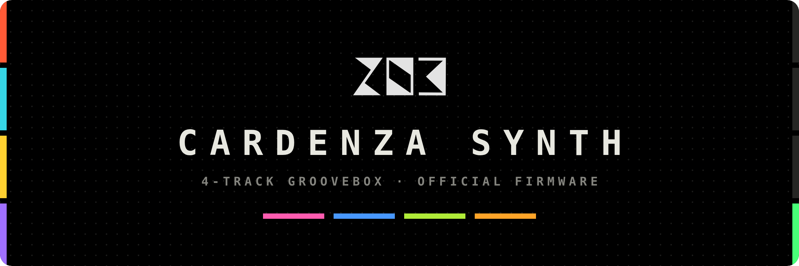
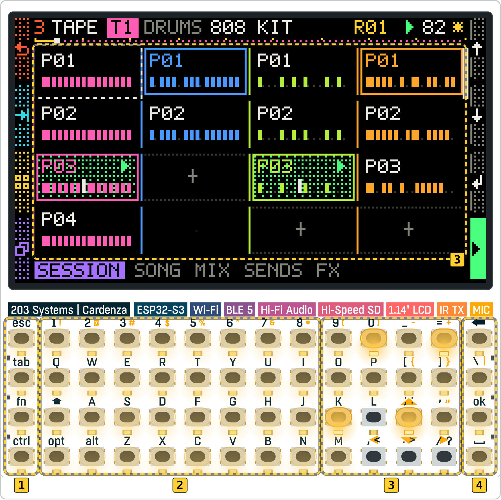
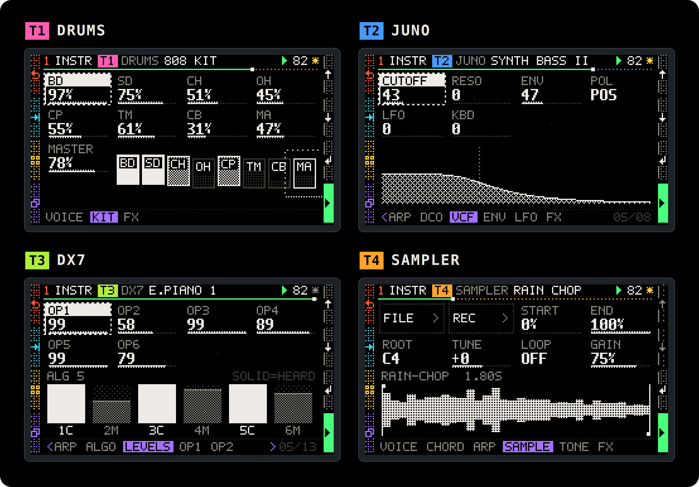
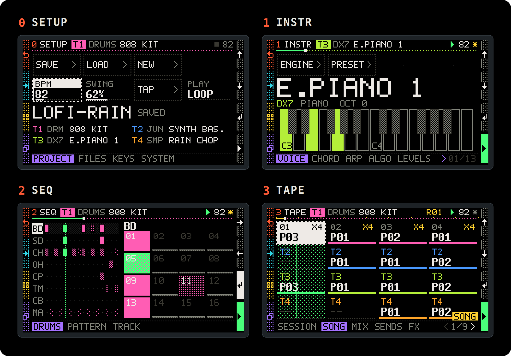
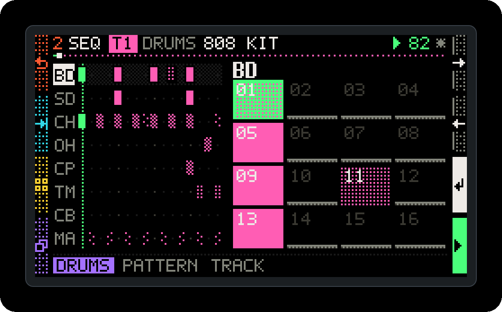
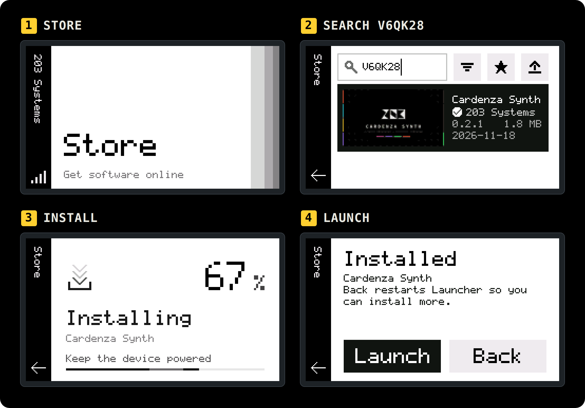

<p align="center"><b>English</b> · <a href="README.zh-CN.md">中文</a></p>

<p align="center">
  
</p>

<p align="center">
  The official four-track groovebox firmware of the <b>203 Systems Cardenza</b> (鸣片), an ESP32-S3 pocket synthesizer,
  built on <a href="https://github.com/203-Systems/CardenzaHAL">CardenzaHAL</a>, the Cardenza's firmware SDK.
  To make a firmware of your own: CardenzaHAL and <a href="https://github.com/203-Systems/203-CLI">203-CLI</a> (<code>203c</code>).
</p>

<p align="center">
  <a href="https://203.io/products/cardenza-mini-synthsiser">Website</a> ·
  <a href="https://cardenza.203.io">Learn</a> ·
  <a href="https://stage.203.io/V6QK28">Community page</a> ·
  <a href="https://cardenza-synth.vercel.app">Web simulator</a> ·
  <a href="https://stage.203.io/develop">Make your own firmware</a>
</p>

## The device

<p align="center">
  
</p>

A 240 × 135 screen over 56 keys. Every key has a fixed role and a light that says what it does now: off (nothing there), half (there, not chosen) or full (chosen, held or playing). Hold a key of the left column and the GRID becomes a map of what it switches.

| Key | Tap | Hold |
|---|---|---|
| **1** ESC | Next scene: INSTR → SEQ → TAPE; cancel, back | Scene map on the GRID (its first column is SETUP) |
| **1** TAB | Next track | Track map: select, mute, solo, sequencer on / off |
| **1** FN | This screen's menu | Run a menu item from the GRID; FN + a letter is its shortcut |
| **1** CTRL | Next page | Page map: jump to any page of the scene |
| **2** PADS | 4 × 8 keys that play the current track: piano, scale or chromatic; on drums a column per drum, a row per velocity | |
| **3** GRID | 4 × 4 keys, the screen's 4 × 4 cells where they sit on the screen: steps, parameters, patterns, tracks | Hold a parameter: the pads become its values |
| **4** ADD / SUB | Change a value, move in a list | Repeat, faster as you hold; FN + ADD / SUB for big steps |
| **4** ENTER | Confirm, open, switch | In SEQ: the record panel |
| **4** PLAY | Play / stop | FN + PLAY: live recording on / off |

In SEQ, hold a pad and tap steps to write its notes; tap a step to select it, then the pads add or remove notes, ENTER picks what ADD / SUB change (note, length, velocity, timing, hits). FN + S saves the project, FN + ESC stops everything. The side key HOME opens the system menu (back to the Launcher, restart, power off).

## Four tracks, four engines

<p align="center">
  
</p>

| Track | Engine | Sound |
|---|---|---|
| **T1** | Drums | An 808 kit of eight drums (BD SD CH OH CP TM CB MA), each with its level |
| **T2** | Juno | A Juno-style analogue voice: DCO, filter, envelope, LFO, chorus; 128 factory patches |
| **T3** | DX7 | Six-operator FM, 32 algorithms; the 128 ROM voices |
| **T4** | Sampler | WAV files from the SD card (up to 5 minutes: long ones play from the card) or a recording from the microphone |

Those are a new project's tracks: each track can run any of the four engines. Every track has its own chord and arpeggiator (the drums aside) and its own effects (drive, bit crush, DJ filter, chorus) with sends to a tempo-synced tape delay and a reverb; the master bus adds EQ, a compressor and tape saturation. The voices are rendered by [AMY](https://github.com/shorepine/amy) on both cores of the ESP32-S3.

## Three scenes and a setup

<p align="center">
  
</p>

- **0 SETUP**: the project (save, load, new, BPM, swing, loop or song) and its files, the keyboard (piano, scale or chromatic, 14 scales, root, octave) and the device (volume, key lights, screen, log, theme). Hold ESC and press the GRID's first column.
- **1 INSTR**: the current track's sound, in signal order: preset, chord, arpeggiator, the engine's pages, effects.
- **2 SEQ**: what the track plays. 16 patterns a track, each 1 to 256 steps, shown 16 steps at a time on the GRID, as a piano roll or a step grid (on drums, the drum machine). Live recording, and the last takes you played are kept to drop into a new pattern.
- **3 TAPE**: all four tracks: launch patterns, arrange them into a song, mix, sends and master effects.

A tap on ESC goes round 1 → 2 → 3. The drum machine, playing:

<p align="center">
  
</p>

## Install and update

Cardenza Synth is installed and updated from the 203 Launcher, which every Cardenza has.

<p align="center">
  
</p>

1. On the Launcher's home screen open the **Store** (on Wi-Fi; the first time it asks for your network).
2. Type the code **V6QK28** (Launcher 0.3.1 or newer), or pick Cardenza Synth from the list, and press OK.
3. Choose a channel (stable is the released one) and press OK. When it is installed already, it asks whether to replace it.
4. **Launch** opens it.

Without Wi-Fi, open its [community page](https://stage.203.io/V6QK28) in Chrome or Edge, connect the Cardenza with a USB cable and press **Install over USB**. Newer versions come from the Store's Updates tool or the same page. To get back to the Launcher, press HOME and choose Back to Launcher.

Projects, presets, samples and settings are on the SD card, below `CardenzaSynth/`, so a new version opens on your last project. Your working state is saved to the card by itself, shortly after the keys come to rest, and comes back at the next start: the power can be pulled at any time. A run started without a card saves nothing: put one in and restart. The layout is the [storage protocol](docs/app-storage-protocol.md).

## More

- **Learn**: the lessons at [cardenza.203.io](https://cardenza.203.io). With the Cardenza on USB, the device follows each step of a lesson and lights the keys it asks for.
- **USB**: MIDI in and out (channels 1 to 4 play tracks 1 to 4, and what the Cardenza plays goes out on its track's channel) and USB audio: your computer records what it plays.
- **Web simulator**: the same firmware in a browser, at [cardenza-synth.vercel.app](https://cardenza-synth.vercel.app).
- **Screen themes**: DARK, LIGHT and RETRO (SETUP > SYSTEM > THEME).

## Build

Initialise the submodules first:

```sh
git submodule update --init --recursive
```

The firmware needs ESP-IDF 5.3.5; in a terminal with the ESP-IDF environment loaded:

```sh
make DEVICE=Cardenza build
```

Desktop simulator and tests:

```sh
cmake -S . -B build/host -DDEVICE=CardenzaSim -DBUILD_TESTING=ON
cmake --build build/host --config Debug
ctest --test-dir build/host -C Debug --output-on-failure
```

The browser simulator needs the Emscripten SDK:

```sh
make web
make web-serve
```

- [Firmware build and flashing](Devices/Cardenza/README.md)
- [Desktop simulator, screenshots and tests](Devices/CardenzaSim/README.md)
- [Browser simulator](Devices/CardenzaWeb/README.md)
- [Development rules and design](AGENT.md)
- [Demo generator](tools/demo/README.md)

## Make your own

To make a firmware of your own from CardenzaSynth and share it, install [203-CLI](https://github.com/203-Systems/203-CLI) first: the 203 community's command line `203c` (Node.js 18 or newer), with an Agent Skill for AI coding assistants and the development guide and hardware notes of every 203 device (Cardenza, 零序, 魔矩); the Cardenza's are in [`products/cardenza`](https://github.com/203-Systems/203-CLI/blob/main/products/cardenza/README.md):

```sh
npm install -g 203c              # 203-CLI's command (macOS, Linux, Windows)
203c skill install               # its Agent Skill, for Claude Code and Codex
203c login                       # approve in the browser, on the community site (--no-browser when remote)
203c fork V6QK28 my-synth        # clones the source, makes the fork in the community, writes 203.json (forked_from)
cd my-synth && git submodule update --init --recursive
# change name and summary in 203.json, change the code, raise version.txt, then
make DEVICE=Cardenza build
203c publish --dry-run
203c publish
```

The project rules (the environment, the files a firmware needs, how to use the HAL, what the community checks before a release, versions and channels, forks, what must never be committed) are in one place: CardenzaHAL's [docs/FIRMWARE-PROJECT.md](https://github.com/203-Systems/CardenzaHAL/blob/main/docs/FIRMWARE-PROJECT.md), where the community's [developer guide](https://stage.203.io/develop) starts too. `203.json` at the root is this firmware in the community (Cardenza Synth, code `V6QK28`); its version is `version.txt`, so `203.json` has no `version`.

## Releases

The official firmware and every third-party firmware are released the same way: CI publishes to the 203 community (the Launcher installs and updates firmware from there), on the channel the Git reference names (`.github/workflows/firmware.yml`, the same rules as CardenzaHAL's `community-publish` action):

| Reference | Community channel | Version |
|---|---|---|
| A push to `main` | dev | `<version.txt>-dev.<run number>` |
| A tag `vX.Y.Z` (equal to `version.txt`) | stable | `X.Y.Z`, the notes from `## X.Y.Z` in `CHANGELOG.md` |
| A tag `vX.Y.Z-beta.N` | beta | `X.Y.Z-beta.N` (the notes from `## X.Y.Z-beta.N` when there is one, otherwise a line naming the beta) |

- A stable release: once it passes on the board, set `version.txt` to the new version, write its section in `CHANGELOG.md`, merge to `main`, then tag `vX.Y.Z` and push the tag.
- Trusted publishing, no community secret: the job signs in with GitHub's OIDC token, and the community accepts only the repository and workflow the firmware's owner linked under Auto publish on V6QK28's page (`203-Systems/CardenzaSynth`, `firmware.yml`).
- Every version carries the source archive of its commit; the ELF stays in the run's artifact (90 days), and a tag's BIN and ELF also go on its GitHub Release.
- Transition: some devices still run Launcher 0.2.0, which reads only the old Launcher hub's catalog, so builds of `main` and stable releases are mirrored to the hub as well (`LAUNCHER_APP_TOKEN`, as before); when the community sees no device report Launcher 0.2.0 any more, the step and the secret go.
- Building from source and flashing it yourself works as always, but it is not a release.

## Related

- [CardenzaHAL](https://github.com/203-Systems/CardenzaHAL): the Cardenza's hardware layer and firmware SDK, which every Cardenza firmware builds on.
- [203-CLI](https://github.com/203-Systems/203-CLI): `203c`, the 203 community's command line, and the device guides.
- [Cardenza-Hardware](https://github.com/203-Systems/Cardenza-Hardware): the Cardenza's schematics and hardware documentation.
- [203-Systems/amy](https://github.com/203-Systems/amy): our branch of the AMY synthesizer.

## Credits

- **[M5Stack Cardputer](https://docs.m5stack.com/en/core/Cardputer)**: a wonderful project. It inspired the Cardenza and is why we set out to make it; thank you to the M5Stack team. The Cardenza is not compatible with M5Stack devices, and this firmware is built for the Cardenza only.
- **[AMY](https://github.com/shorepine/amy)** (Brian Whitman and Daniel PW Ellis, MIT): the synthesis engine behind the four engines. We keep a branch of it, [203-Systems/amy](https://github.com/203-Systems/amy).
- **[ESP-IDF](https://github.com/espressif/esp-idf)** and **[TinyUSB](https://github.com/hathach/tinyusb)**: the frameworks the firmware and its USB are built on.
- **[Emscripten](https://emscripten.org)**: runs the same code in a browser, which is what the web simulator is.
- **[Docusaurus](https://docusaurus.io)**: the Learn site.
