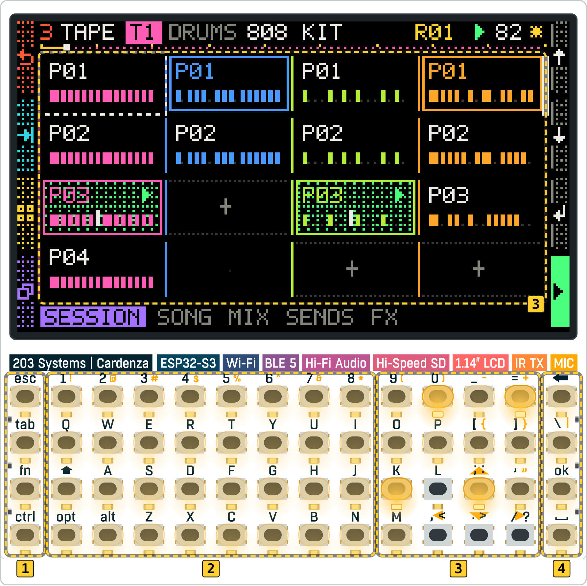
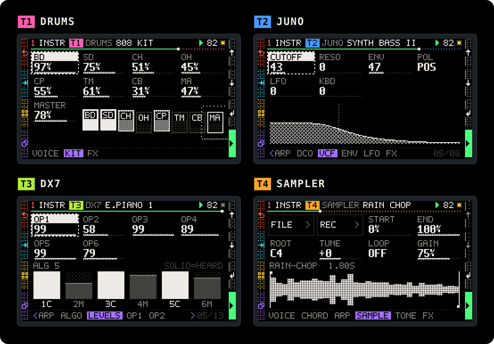
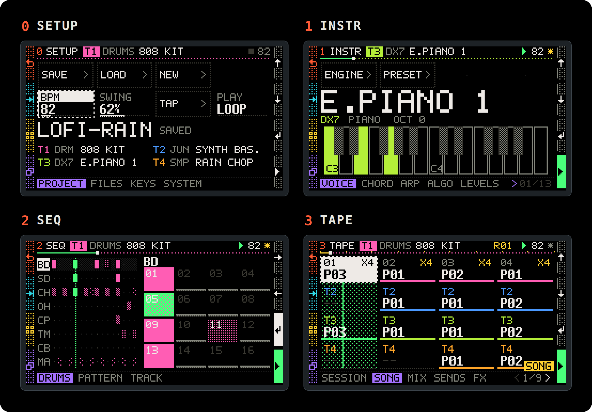
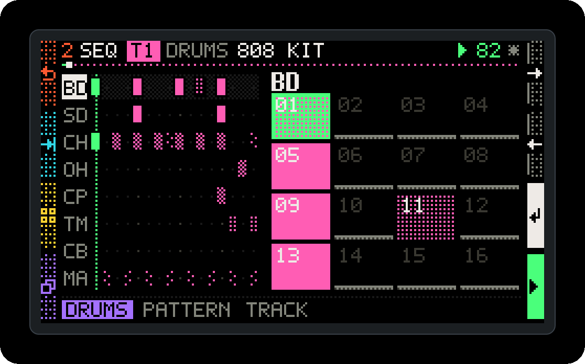
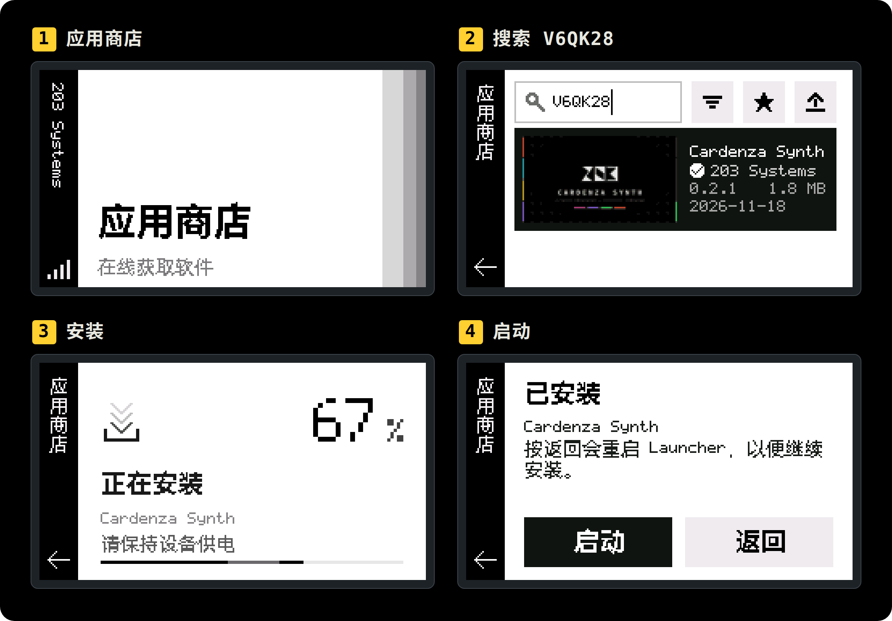

<p align="center"><a href="README.md">English</a> · <b>中文</b></p>

<p align="center">
  
</p>

<p align="center">
  <b>203 Systems 鸣片</b>（Cardenza，ESP32-S3 掌上合成器）的官方四轨 groovebox 固件，基于鸣片的固件 SDK <a href="https://github.com/203-Systems/CardenzaHAL">CardenzaHAL</a>。想做自己的固件：CardenzaHAL 和 <a href="https://github.com/203-Systems/203-CLI">203-CLI</a>（<code>203cli</code>）。
</p>

<p align="center">
  <a href="https://203.io/products/cardenza-mini-synthsiser">官网</a> ·
  <a href="https://cardenza.203.io/zh-Hans/">教程与手册</a> ·
  <a href="https://cardenza.203.io/community/V6QK28">社区页面</a> ·
  <a href="https://cardenza-synth.vercel.app">浏览器模拟器</a> ·
  <a href="https://cardenza.203.io/community/develop">做自己的固件</a>
</p>

## 机器

<p align="center">
  
</p>

240 × 135 的屏幕，下面 56 个键。每个键的作用固定，键灯说明它此刻做什么：灭（这里什么都没有）、半亮（有东西，没选中）、全亮（选中、按住或正在发声）。按住左列的任一个键，GRID 就变成它所切换内容的地图。

| 键 | 单击 | 按住 |
|---|---|---|
| **1** ESC | 下一个场景：乐器 → 音序器 → 走带；取消 / 返回 | GRID 上的场景地图（第一列进入 SETUP） |
| **1** TAB | 下一轨 | 轨道地图：选轨、静音、独奏、音序开关 |
| **1** FN | 当前画面的菜单 | 用 GRID 执行菜单项；FN + 字母是它的快捷键 |
| **1** CTRL | 下一页 | 页面地图：直接跳到场景里的任一页 |
| **2** PADS | 4 × 8 个键，演奏当前轨：钢琴、音阶或半音排列；鼓轨每列一种鼓、每行一种力度 | |
| **3** GRID | 4 × 4 个键，就是屏幕上同样位置的 4 × 4 格子：step、参数、Pattern、轨道 | 按住参数格：演奏区变成它的档位 |
| **4** ADD / SUB | 调值，或在列表里移动 | 连发，越按越快；FN + ADD / SUB 大步调整 |
| **4** ENTER | 确认、进入、切换 | SEQ 中打开录音面板 |
| **4** PLAY | 播放 / 停止 | FN + PLAY 开关实时录音 |

在 SEQ 中，按住演奏键再点 step 写入它的音；点 step 选中后，用 PADS 加减音，ENTER 选择 ADD / SUB 调整的项（音高、时值、力度、微步、连击）。FN + S 保存工程，FN + ESC 全部停止。侧边的 HOME 键打开系统菜单（回到 Launcher、重启、关机）。

## 四轨，四种音源

<p align="center">
  
</p>

| 轨道 | 音源 | 声音 |
|---|---|---|
| **T1** | Drums | 808 鼓组，八种鼓（BD SD CH OH CP TM CB MA），每种鼓有自己的电平 |
| **T2** | Juno | Juno 式模拟音色：DCO、滤波、包络、LFO、Chorus；128 个出厂音色 |
| **T3** | DX7 | 六算子 FM，32 种算法；128 个 ROM 音色 |
| **T4** | Sampler | SD 卡上的 WAV 文件（最长 5 分钟，长采样从卡上边读边播），或用麦克风录一段 |

这是新工程的四轨：每一轨都可以换成四种音源中的任何一种。每条轨道有自己的和弦与琶音器（鼓轨除外）和自己的效果（DRIVE、CRUSH、DJ 滤波、CHORUS），发送到按速度同步的磁带延迟和混响；总线上还有 EQ、压缩和磁带饱和。声音由 [AMY](https://github.com/shorepine/amy) 在 ESP32-S3 的两个核心上渲染。

## 三个场景和设置

<p align="center">
  
</p>

- **0 SETUP 设置**：工程（保存、载入、新建、BPM、Swing、循环或整曲）与文件、键盘（钢琴、音阶或半音排列，14 种音阶、根音、八度）和设备（音量、键灯、屏幕、日志、主题）。按住 ESC 再按 GRID 第一列进入。
- **1 INSTR 乐器**：当前轨的声音，按信号顺序排：音色、和弦、琶音器、音源的参数页、效果。
- **2 SEQ 音序器**：当前轨弹什么。每轨 16 个 Pattern，每个 1–256 步，GRID 一次显示 16 步，屏幕上是钢琴卷帘或步进矩阵（鼓轨是鼓机）。支持实时录音；最近弹过的几段也会留着，可以放进一个新 Pattern。
- **3 TAPE 走带**：四轨合在一起：发射 Pattern、编排整首歌、混音、发送和总线效果。

单击 ESC 按 1 → 2 → 3 循环。正在播放的鼓机：

<p align="center">
  
</p>

## 安装与更新

Cardenza Synth 通过 203 Launcher（启动器，每台鸣片都有）安装和更新。

<p align="center">
  
</p>

1. 在启动器主屏幕打开 **应用商店**（要连 Wi-Fi；第一次会先请你选网络）。
2. 输入代码 **V6QK28**（启动器 0.3.1 起），或在列表里选 Cardenza Synth，按 OK。
3. 选择渠道（稳定版是正式发布的那一版），按 OK。已经装过时，它会问要不要替换。
4. 按 **启动** 打开。

没有 Wi-Fi 时，在 Chrome 或 Edge 里打开它的[社区页面](https://cardenza.203.io/community/V6QK28)，用 USB 线连上鸣片，点「用 USB 线安装」。新版本可以用应用商店里的「更新」工具安装，也可以在同一个页面安装。回到启动器：按 HOME，选「返回启动器」。

工程、音色、采样和设置都在 SD 卡的 `CardenzaSynth/` 目录里，所以新版本打开时接着你上次的工程。工作状态会在按键停下后不久自动存到卡上，下次开机恢复：随时拔电都可以。开机时没插 SD 卡，这次运行不保存任何数据；插卡后需重启。目录结构见[存储协议](docs/app-storage-protocol.md)。

## 更多

- **教程**：[cardenza.203.io](https://cardenza.203.io/zh-Hans/) 上的课程。鸣片用 USB 接上电脑时，机器会跟着课程的每一步走，并点亮这一步要按的键。
- **USB**：MIDI 输入和输出（通道 1–4 弹轨道 1–4，鸣片弹出的音从它那条轨道的通道发出），以及 USB 音频：电脑可以录下鸣片的声音。
- **浏览器模拟器**：同一份固件在浏览器里运行：[cardenza-synth.vercel.app](https://cardenza-synth.vercel.app)。
- **屏幕主题**：DARK、LIGHT、RETRO（SETUP > SYSTEM > THEME）。

## 构建

先初始化子模块：

```sh
git submodule update --init --recursive
```

固件需要 ESP-IDF 5.3.5，在已加载 ESP-IDF 环境的终端运行：

```sh
make DEVICE=Cardenza build
```

主机模拟器与测试：

```sh
cmake -S . -B build/host -DDEVICE=CardenzaSim -DBUILD_TESTING=ON
cmake --build build/host --config Debug
ctest --test-dir build/host -C Debug --output-on-failure
```

浏览器模拟器需要 Emscripten SDK：

```sh
make web
make web-serve
```

- [固件构建与烧录](Devices/Cardenza/README.md)
- [桌面模拟器、截图与测试](Devices/CardenzaSim/README.md)
- [浏览器模拟器](Devices/CardenzaWeb/README.md)
- [开发规则与设计](AGENT.md)
- [Demo 生成工具](tools/demo/README.md)

## 做自己的版本

想在 CardenzaSynth 上改出自己的固件并分享，先装 [203-CLI](https://github.com/203-Systems/203-CLI)：203 社区的命令行 `203cli`（需要 Node.js 18 以上），附给 AI 编程助手用的 Agent Skill，以及每台 203 设备（鸣片、零序、魔矩）的开发指引和硬件资料，鸣片的在 [`products/cardenza`](https://github.com/203-Systems/203-CLI/blob/main/products/cardenza/README.md)：

```sh
npm install -g 203cli            # 203-CLI 的命令（macOS、Linux、Windows 都一样）
203cli skill install             # 它的 Agent Skill，给 Claude Code 和 Codex
203cli login                     # 打开浏览器，在社区网站上批准（远程时加 --no-browser）
203cli fork V6QK28 my-synth      # 克隆源码，在社区建 Fork，写好 203.json（forked_from）
cd my-synth && git submodule update --init --recursive
# 改 203.json 的 name 和 summary，改代码，提高 version.txt，然后
make DEVICE=Cardenza build
203cli publish --dry-run
203cli publish
```

工程规则（环境、必需的文件、HAL 的用法、社区发布前检查什么、版本与渠道、Fork、绝不能提交的东西）只有一份：CardenzaHAL 的 [docs/FIRMWARE-PROJECT.md](https://github.com/203-Systems/CardenzaHAL/blob/main/docs/FIRMWARE-PROJECT.md)，社区的[开发指引](https://cardenza.203.io/community/develop)也从它开始。根目录的 `203.json` 是这个固件在社区里的信息（Cardenza Synth，代码 `V6QK28`）；版本号就是 `version.txt`，所以 `203.json` 里没有 `version`。

## 发布

官方固件和所有第三方固件用同一种方式发布：由 CI 发到 203 社区（Launcher 从社区安装和更新固件），渠道跟着 Git 引用走（`.github/workflows/firmware.yml`，规则同 CardenzaHAL 的 `community-publish` action）：

| 引用 | 社区渠道 | 版本号 |
|---|---|---|
| 推送到 `main` | dev | `<version.txt>-dev.<运行号>` |
| 标签 `vX.Y.Z`（等于 `version.txt`） | stable | `X.Y.Z`，更新说明取 `CHANGELOG.md` 的 `## X.Y.Z` |
| 标签 `vX.Y.Z-beta.N` | beta | `X.Y.Z-beta.N`（有 `## X.Y.Z-beta.N` 就用它作更新说明，没有就是一行说明这是哪个测试版） |

- 发一个正式版：板上测试通过后，把 `version.txt` 改成新版本，在 `CHANGELOG.md` 写好这一节，合进 `main`，再打 `vX.Y.Z` 标签并推送。
- 受信任发布，不存社区的密钥：发布作业用 GitHub 的 OIDC 令牌登录，社区只认固件主人在 V6QK28 的固件页「自动发布」里关联的仓库和工作流（`203-Systems/CardenzaSynth`，`firmware.yml`）。
- 每个版本带上这次提交的源码包；ELF 留在这次运行的 artifact 里（90 天），标签的 BIN 和 ELF 也放进 GitHub Release。
- 过渡期：还有设备在用 Launcher 0.2.0（它只读旧 Launcher hub 的目录），所以 `main` 的构建和正式版同时镜像到 hub（`LAUNCHER_APP_TOKEN`，和以前一样）；社区看到已经没有设备报告 0.2.0 的 Launcher 时，去掉这一步和这个密钥。
- 自己从源码编译、本地烧录照样可以，但那不是发布。

## 相关仓库

- [CardenzaHAL](https://github.com/203-Systems/CardenzaHAL)：鸣片的硬件层和固件 SDK，所有鸣片固件都基于它。
- [203-CLI](https://github.com/203-Systems/203-CLI)：203 社区的命令行 `203cli` 和各设备的开发指引。
- [Cardenza-Hardware](https://github.com/203-Systems/Cardenza-Hardware)：鸣片的原理图和硬件资料。
- [203-Systems/amy](https://github.com/203-Systems/amy)：我们维护的 AMY 合成器分支。

## 致谢

- **[M5Stack Cardputer](https://docs.m5stack.com/en/core/Cardputer)**：一个很棒的项目。它是鸣片的灵感来源，也是我们动手做鸣片的初衷，谢谢 M5Stack 团队。鸣片不兼容 M5Stack 的设备，这里的固件也只为鸣片构建。
- **[AMY](https://github.com/shorepine/amy)**（Brian Whitman 与 Daniel PW Ellis，MIT）：四种音源背后的合成引擎。我们在它之上维护分支 [203-Systems/amy](https://github.com/203-Systems/amy)。
- **[ESP-IDF](https://github.com/espressif/esp-idf)** 与 **[TinyUSB](https://github.com/hathach/tinyusb)**：固件和 USB 所基于的框架。
- **[Emscripten](https://emscripten.org)**：让同一份代码在浏览器里运行，网页模拟器靠它。
- **[Docusaurus](https://docusaurus.io)**：教程与手册网站。
