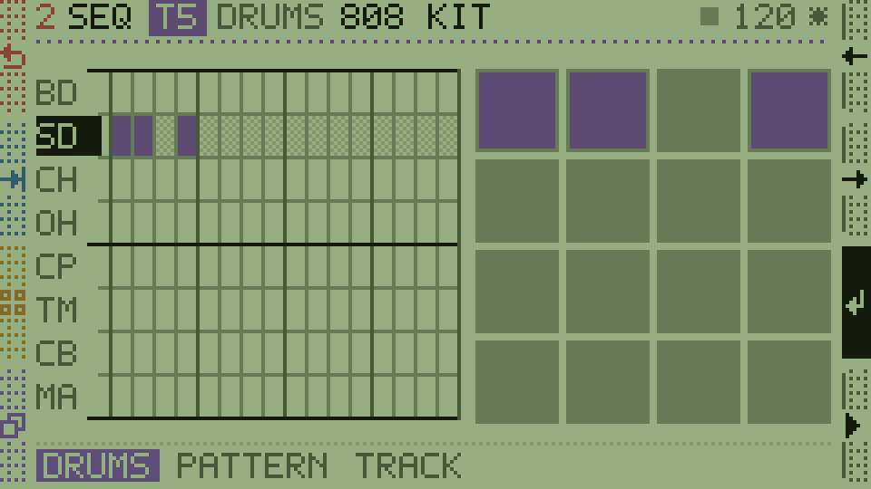
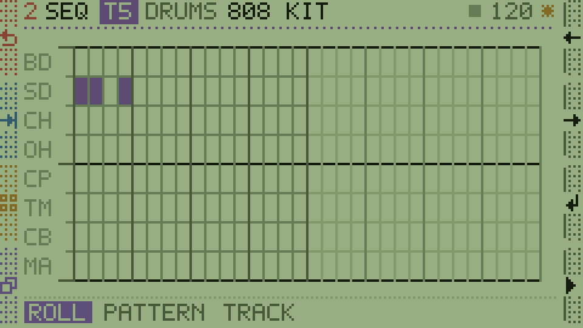

# 屏幕主题：STOCK 与 LCD Green（MPC2500 风格）

两套屏幕可选：**STOCK** 是固件出厂那套深色霓虹，**RETRO** 是淡绿底、墨色点阵的 MPC 风格。
切换在 **SETUP → SYSTEM 页第二行第一格 `THEME`**，按 ADD / SUB 或点一下格子即可，设置写进
`sys.theme`（system.cfg），跟工程无关，重启后保持。

两套调色板都定义在 `Applications/Synth/UI/Groove/Render/Theme.h`（`kOfficialPalette` /
`kLcdGreenPalette`），所有颜色是运行期变量，`theme::SetTheme()` 一次整体替换，绘制代码不需要知道
屏幕是哪一种。




## 一、设计规则

1. **纸与墨**：`kBlack` 是"纸"（清屏/面板底色），`kInk` 是"墨"（所有前景）。两者的名字沿用深色主题的语义，
   所以整套 UI 是靠**反转这五个值**完成的，没有一处绘制代码被改。
2. **五级灰阶阶梯**，从亮到暗，中间不留其它颜色：

   | 常量 | 用途 | 亮度关系 |
   |---|---|---|
   | `kBlack` | 纸：背景、面板底 | 最亮 |
   | `kShade` | 键的阴影、黑键底纹 | 略暗于纸 |
   | `kFaint` | 细线、次级标注 | 暗 |
   | `kDim` | 第二读数（行名、注释文字） | 更暗 |
   | `kInk` | 墨：正文、音符、选中块 | 最暗 |

3. **抖动即点阵**：原有的 4×4 Bayer 抖动在亮底上变成"墨点密度"，正好是电子点阵屏的质感，所以
   `kDither*` 密度一个都没改。
4. **彩色只做区分，不做发光**：亮底上的彩色必须暗到能当"带色的墨"，不饱和度不能高，否则在绿底上直接
   糊掉或变成荧光。

## 二、色值

`Rgb565` 存的是 5-6-5 量化色，十六进制是四舍五入后的近似值。

### 灰阶（纸 → 墨）

| 常量 | RGB565 | ≈ HEX | 说明 |
|---|---|---|---|
| `kBlack` | 170,196,150 | `#AAC496` | 背光绿纸 |
| `kShade` | 148,172,126 | `#94AC7E` | 键影 |
| `kFaint` | 116,140,98 | `#748C62` | 细线 |
| `kDim` | 82,101,68 | `#526544` | 第二读数 |
| `kInk` | 24,32,20 | `#182014` | 墨 |

### 四个左侧键（压暗的染料色）

| 键 | 常量 | RGB565 | ≈ HEX | 原来的亮色 |
|---|---|---|---|---|
| ESC（场景/返回） | `kEsc` | 158,76,56 | `#9E4C38` | 橙 `#FF5A36` |
| TAB（轨道） | `kTab` | 56,104,126 | `#38687E` | 青 `#36D6E6` |
| FN（第二功能） | `kFn` | 150,120,44 | `#96782C` | 黄 `#FFD030` |
| CTRL（页面） | `kCtrl` | 108,88,138 | `#6C588A` | 紫 `#A070FF` |

### 六个轨道色（同权重的墨，只靠染料区分）

| 轨道 | RGB565 | ≈ HEX | 色相 |
|---|---|---|---|
| T1 | 150,70,58 | `#96463A` | 陶土 |
| T2 | 58,82,128 | `#3A5280` | 靛蓝 |
| T3 | 94,112,52 | `#5E7034` | 橄榄 |
| T4 | 148,114,44 | `#94722C` | 赭黄 |
| T5 | 104,84,132 | `#685484` | 梅紫 |
| T6 | 52,108,104 | `#346C68` | 青灰 |

### 播放 / 录音

| 常量 | RGB565 | ≈ HEX | 说明 |
|---|---|---|---|
| `kPlay` | 0,0,0 | `#000000` | 正在播放：比墨更黑，最醒目 |
| `kRec` | 150,52,46 | `#96342E` | 待录：暗红 |

## 三、怎么改

只改 `Theme.h` 上半部分的常量：

```cpp
inline constexpr Color kBlack = Rgb565(170, 196, 150);  // 纸
inline constexpr Color kInk = Rgb565(24, 32, 20);       // 墨
inline constexpr Color kDim = Rgb565(82, 101, 68);
inline constexpr Color kFaint = Rgb565(116, 140, 98);
inline constexpr Color kShade = Rgb565(148, 172, 126);
```

- **换底色**：动 `kBlack` 即可（例如更黄的纸 `Rgb565(178, 190, 140)`）；其余四级灰阶按"比纸略暗 → 最墨"
  重新拉一遍，保持亮度顺序，不要跳出这个顺序，否则会出现"灰线比文字亮"的错乱。
- **调轨道色**：改 `kTrackColors[6]`。原则是六个色的**明度接近、饱和中等**，否则某一条轨道会跳出来。
  可在亮底上先取一个 40–50% 明度的灰，再往色相上偏。
- **新增颜色**：不要写 `Rgb565(...)` 到绘制代码里——`Render/` 下除了 `Theme.h` 没有任何硬编码颜色，
  保持这个约定，换主题才只需要改一个文件。

## 四、看效果

```bash
export EMSDK=/path/to/emsdk
export PATH="$EMSDK/upstream/emscripten:$EMSDK/node/*:$PATH"
cmake --build build/v3 --target CardenzaWeb
python _run/serve8000.py        # 打开 http://127.0.0.1:8000/
```

真机固件同样一套颜色，重新 `_run/build_fw.bat` 即可。

## 五、回到深色主题

把五个灰阶换回原来的深色档位即可（彩色也要换回高饱和版本，深底上暗彩会看不见）：

```cpp
inline constexpr Color kBlack = Rgb565(0, 0, 0);          // 纸 = 黑
inline constexpr Color kInk = Rgb565(232, 232, 224);      // 墨 = 米白
inline constexpr Color kDim = Rgb565(132, 132, 126);
inline constexpr Color kFaint = Rgb565(58, 58, 54);
inline constexpr Color kShade = Rgb565(26, 26, 24);
// 轨道色：粉 255,92,176 / 蓝 72,152,255 / 柠檬 176,236,56 / 琥珀 255,164,40 / 紫 196,132,255 / 薄荷 96,240,200
// 左键：橙 255,90,54 / 青 54,214,230 / 黄 255,208,48 / 紫 160,112,255
```

`git log -- Applications/Synth/UI/Groove/Render/Theme.h` 里能翻到两套配色的原始提交。
